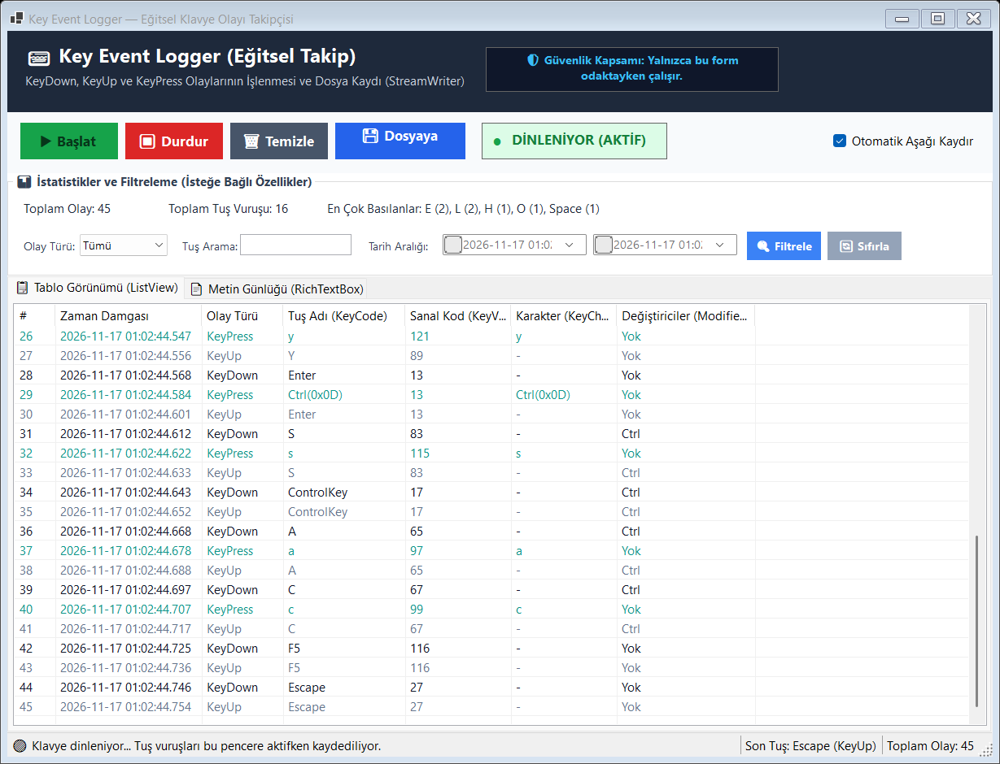
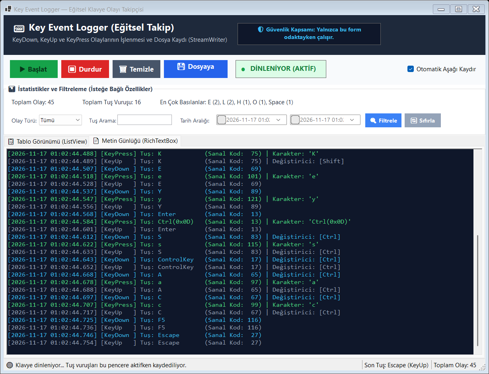

# ⌨️ Key Event Logger (Eğitsel Klavye Olayı Takipçisi)

[](https://dotnet.microsoft.com/)
[](https://learn.microsoft.com/en-us/dotnet/desktop/winforms/)
[](https://learn.microsoft.com/en-us/dotnet/csharp/)
[](LICENSE)

Bu proje, **Nesne Tabanlı Programlama (YMH219)** dersi kapsamında hazırlanmış eğitsel bir Windows Forms masaüstü uygulamasıdır. Klavye donanım olaylarının (`KeyDown`, `KeyUp`, `KeyPress`) işletim sistemi ve form seviyesinde nasıl yakalandığını, olay argümanlarının (`KeyEventArgs`, `KeyPressEventArgs`) nasıl çözümlendiğini, veri modellemeyi ve dosya akışları (`StreamWriter`) ile raporlamayı uygulamalı olarak gösterir.

---

## 🛡️ Kapsam ve Güvenlik Sınırı

> [!IMPORTANT]
> **Bu uygulama gerçek veya kötü amaçlı bir sistem keylogger'ı DEĞİLDİR.**
> 
> - **Sadece Odaklı Pencere:** Uygulama yalnızca kendi Windows Forms penceresi ekranda odaktayken (`KeyPreview = true`) tuş olaylarını yakalar.
> - **Global Hook İçermez:** Sistem genelini izleyen Windows API kancaları (`SetWindowsHookEx`), arka planda gizli çalışma, başlangıçta otomatik çalışma veya parola yakalama mekanizmaları **kesinlikle kullanılmamıştır ve yer almaz**.
> - **Ağ İletişimi Yoktur:** Hiçbir veri dışarı aktarılmaz veya uzak bir sunucuya gönderilmez. Tüm işlemler tamamen yerel bellek ve kullanıcının seçtiği yerel `.txt` dosyasıyla sınırlıdır.

---

## 🚀 Temel Özellikler

### Asgari Uygulama Gereksinimleri
- ✅ **Klavye Olaylarının İzlenmesi:** Pencere aktifken gerçekleşen `KeyDown`, `KeyUp` ve `KeyPress` olayları milisaniye hassasiyetli zaman damgasıyla listelenir.
- ✅ **Kayıt Durumu Kontrolü:** **Başlat** ve **Durdur** butonları ile klavye dinleme anlık olarak açılıp kapatılabilir.
- ✅ **Açık Durum Göstergesi:** Dinleme modunun aktif (🟢 Yeşil) veya pasif (🔴 Kırmızı) olduğunu belirten canlı rozet ve durum çubuğu.
- ✅ **Ekranı Temizleme:** **Temizle** butonu ile ekrandaki ve bellekteki tüm kayıtlar onay kutusu sonrası sıfırlanabilir.
- ✅ **Yerel Dosyaya Kaydetme (.txt):** `StreamWriter` ve `SaveFileDialog` kullanılarak, UTF-8 formatında başlık, detay satırları ve istatistik özeti içeren rapor dosyası üretilir.
- ✅ **Hata Yönetimi (Exception Handling):** Dosya G/Ç (`IOException`, `UnauthorizedAccessException`) işlemleri güvenli try-catch blokları ile yönetilir.

### 🌟 İsteğe Bağlı Ek Geliştirmeler (Bonus)
- 📊 **Anlık İstatistik Takibi:** Toplam yakalanan olay sayısı, toplam tuş vuruşu (`KeyDown`) sayısı ve en çok basılan tuşların frekans dağılımı (Top 5).
- 🔍 **Çok Kriterli Filtreleme & Arama:**
  - Olay türüne göre filtreleme (`Tümü`, `KeyDown`, `KeyUp`, `KeyPress`)
  - Tuş adına veya değiştiriciye göre serbest metin arama
  - Tarih/saat aralığına göre filtreleme (`DateTimePicker`)
- 📑 **Çift Görünüm Desteği:**
  - **Tablo Görünümü (`ListView`):** Zaman, Olay Türü, Tuş Adı, Sanal Kod (`KeyValue`), Karakter ve Değiştiriciler (`Ctrl`, `Alt`, `Shift`) için ayrılmış sütunlar.
  - **Metin Günlüğü (`RichTextBox`):** Konsol hissiyatı veren renk kodlu canlı metin akışı.
- ⏬ **Otomatik Kaydırma (Auto-Scroll):** Yeni tuş vuruşları geldiğinde listeyi otomatik olarak en son elemana odaklama.

---

## 📸 Ekran Görüntüleri

### 1. Canlı Klavye Olayı Takibi ve Tablo Görünümü
Uygulama aktifken basılan tuşların anlık olarak zaman damgası, olay türü, sanal kod ve değiştiriciler ile listelenmesi:



---

### 2. Metin Günlüğü (RichTextBox) ve İstatistikler
Kayıtların renk kodlu akış görünümü, durdurulmuş kayıt durumu ve en çok basılan tuş istatistikleri:



---

## 🛠️ Kullanılan Teknolojiler

- **Dil:** C# 13 (.NET 10.0 Windows Desktop SDK)
- **Arayüz Framework'ü:** Windows Forms (WinForms)
- **Olay Tabanlı Programlama:** `Form.KeyPreview`, `KeyEventArgs`, `KeyPressEventArgs`
- **G/Ç İşlemleri:** `System.IO.StreamWriter`, `System.Text.Encoding.UTF8`
- **Veri Yapıları & LINQ:** `Generic List<T>`, `Dictionary<string, int>`, LINQ Filtreleme

---

## 📁 Proje Dizin Yapısı

```text
KeyEventLogger/
├── Models/
│   └── KeyEventModel.cs        # Olay kaydı veri modeli ve metin formatlayıcıları
├── Services/
│   └── KeyEventManager.cs      # Olay kuyruğu, istatistik hesaplama, filtreleme ve dosya yazma
├── screenshots/
│   ├── 01_tablo_ve_aktif_kayit.png
│   └── 02_metin_gunlugu_ve_istatistik.png
├── MainForm.cs                 # Form mantığı ve UI olay bağlayıcıları
├── MainForm.Designer.cs        # Windows Forms kontrolleri ve yerleşim tasarımı
├── Program.cs                  # Uygulama başlangıç noktası
├── KeyEventLogger.csproj       # Proje yapılandırma dosyası
├── .gitignore                  # Derleme çıktılarını (bin, obj, .vs) dışlayan kurallar
└── README.md                   # Proje dokümantasyonu
```

---

## 💻 Kurulum ve Çalıştırma

### Gereksinimler
- [.NET 10.0 SDK](https://dotnet.microsoft.com/download) veya Visual Studio 2022+ (.NET Masaüstü Geliştirme iş yükü ile)
- Windows 10/11 İşletim Sistemi

### Adım Adım Çalıştırma

1. **Depoyu Klonlayın veya İndirin:**
   ```bash
   git clone https://github.com/fatih-mhmt1702/KeyEventLogger.git
   cd KeyEventLogger
   ```

2. **Projeyi Derleyin:**
   ```bash
   dotnet build
   ```

3. **Uygulamayı Başlatın:**
   ```bash
   dotnet run
   ```

4. **Kullanım:**
   - **▶ Başlat** butonuna basarak klavye dinlemeyi aktifleştirin.
   - Form penceresi üzerindeyken klavyeden tuşlara basın (`Enter`, `Shift + A`, `Ctrl + S`, vb.).
   - Yakalanan olayları ister **Tablo Görünümü** ister **Metin Günlüğü** sekmesinden inceleyin.
   - İstatistikler panelinden en sık kullanılan tuşları takip edin.
   - İsteğe bağlı olarak tarih/olay türü filtresi uygulayın.
   - **💾 Dosyaya Kaydet** butonu ile raporu `.txt` formatında dışa aktarın.
   - **⏹ Durdur** ile dinlemeyi kapatın veya **🗑️ Temizle** ile sıfırlayın.

---

## 📝 Örnek Dışa Aktarılan Rapor Dosyası Formatı

```text
==========================================================================================
                      KEY EVENT LOGGER - GÜNLÜK RAPORU                                   
  Eğitsel Amaçlı Klavye Olay Takip Kayıtları (Yalnızca Form Odaklı)                      
  Oluşturulma Tarihi : 2026-11-17 01:05:00
  Toplam Olay Sayısı : 42
==========================================================================================

ZAMAN                  	OLAY TÜRÜ 	TUŞ ADI       	SANAL KOD 	KARAKTER    	DEĞİŞTİRİCİ
-----------------------------------------------------------------------------------------------
2026-11-17 01:04:12.120	KeyDown   	H             	72        	-           	Shift
2026-11-17 01:04:12.122	KeyPress  	H             	72        	H           	Yok
2026-11-17 01:04:12.180	KeyUp     	H             	72        	-           	Shift
2026-11-17 01:04:12.300	KeyDown   	E             	69        	-           	Yok
2026-11-17 01:04:12.302	KeyPress  	e             	101       	e           	Yok
2026-11-17 01:04:12.350	KeyUp     	E             	69        	-           	Yok

==========================================================================================
                                EN ÇOK BASILAN TUŞLAR                                     
==========================================================================================
  E               : 8 kez basıldı
  L               : 5 kez basıldı
  O               : 4 kez basıldı
  Space           : 3 kez basıldı
  Enter           : 2 kez basıldı
==========================================================================================
  Rapor sonu.
```

---

## 📜 Lisans

Bu proje eğitim amaçlı hazırlanmış olup MIT Lisansı ile sunulmaktadır.
